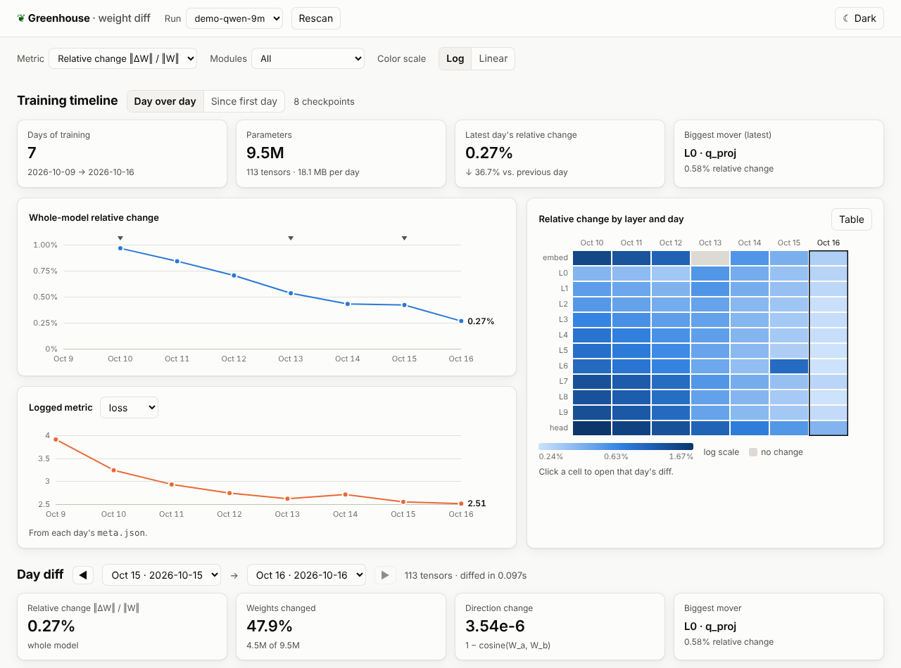

# weightviz: day-over-day weight diffs for Greenhouse

A local web app for seeing **what each day of training did to an LLM's
weights**. Point it at a folder of daily checkpoints and you get:

- **Training timeline:** whole-model change per day, a *layer × day* heatmap,
  and any numbers you log in `meta.json` (loss, lr, …), with a *Day over day*
  or *Since first day* comparison.
- **Day diff:** for any two days, a *layer × module* heatmap (q/k/v/o,
  gate/up/down, norms, embeddings), headline stats, and a sortable table of
  every tensor.
- **Tensor drill-down:** a downsampled map of ΔW (magnitude, signed, or the
  weights themselves), the distribution of ΔW, and the update's singular-value
  spectrum (low-rank versus diffuse updates).

Diffs are computed once in the background and cached on disk. A new day's
checkpoint is picked up automatically within a minute.



## Quick start

Requires Python 3.9+ and numpy. Nothing else: the server is standard library
only and the UI has no build step.

```sh
cd tools/weight-viz
pip install numpy                                  # or: pip install -e .
python -m weightviz demo demo-checkpoints          # synthetic 8-day run (~150 MB)
python -m weightviz serve demo-checkpoints         # → http://127.0.0.1:8765
```

The demo has planted events to find: deeper layers move more early on, the
embeddings are frozen on day 4 (shown as *no change*), and on day 6 a data-mix
change hits layer 6's MLP.

Checkpoints usually live on the training box. Run the server there and tunnel:

```sh
ssh -L 8765:localhost:8765 trainbox 'cd BodyDoubler/tools/weight-viz && python -m weightviz serve /data/greenhouse/checkpoints'
```

The server binds to `127.0.0.1` by default and has **no authentication**, so
don't pass `--host 0.0.0.0` on a shared network.

## Checkpoint convention

Greenhouse should write **one folder per day, per run, in
[safetensors](https://huggingface.co/docs/safetensors) format**:

```
<root>/
  qwen3-1.7b-sft/                     ← run
    2026-10-15/                       ← day (any name; sorted naturally)
      model.safetensors               ← or model-00001-of-00004.safetensors … + model.safetensors.index.json
      meta.json                       ← optional
    2026-10-16/
      …
```

- **Why safetensors:** it can be memory-mapped, so a 15 GB checkpoint opens
  instantly and is streamed one tensor at a time. bf16, fp16, fp32 and fp8 are
  all read bit-exactly. It's also what Hugging Face `save_pretrained` writes by
  default, so HF checkpoints (sharded or not) already follow this layout.
- **Day names:** ISO dates (`2026-10-16`) display as "Oct 16". Anything else
  works too (`step-001200`); folders sort naturally, so `step-9` comes before
  `step-10`.
- **`meta.json`:** any JSON object. Numeric fields (`loss`, `lr`, `tokens`, …)
  become a selectable chart; `notes` shows up as a marker on the timeline.
- **Atomic writes:** write the day folder under a hidden temporary name
  (`.2026-10-16.tmp`) and rename it into place. Folders starting with `.` are
  ignored, and a truncated file is reported as *unreadable* instead of being
  diffed.
- Only `model*.safetensors` files are read when present, so optimizer state
  saved alongside the weights is ignored.

### Writing checkpoints from Greenhouse

`weightviz/greenhouse.py` does all of the above. It needs numpy, plus torch if
you pass torch tensors:

```python
from weightviz.greenhouse import save_daily_checkpoint

# Once a day, on rank 0, with a full (unsharded) state dict:
save_daily_checkpoint(
    model.state_dict(),
    root="/data/greenhouse/checkpoints",
    run="qwen3-1.7b-sft",
    meta={"step": step, "tokens": tokens_seen, "loss": eval_loss, "lr": lr, "notes": "data mix v2"},
)
```

It shards at 4 GB with an HF-style index, keeps bf16/fp8 bit-exact, and
replaces an existing folder for the same day atomically. With FSDP, gather the
full state dict first, e.g.
`torch.distributed.checkpoint.state_dict.get_model_state_dict(model, options=StateDictOptions(full_state_dict=True, cpu_offload=True))`.

If Greenhouse uses Hugging Face, `model.save_pretrained(f"{root}/{run}/{day}")`
(ideally into a temp folder, then renamed) is equivalent; add a `meta.json` next to it.

## Reading the views

| Metric | Definition | Use it for |
|---|---|---|
| **Relative change** | ‖ΔW‖ / ‖W‖ (Frobenius) | Default; comparable across tensors of any size |
| **RMS update** | ‖ΔW‖ / √n | Absolute per-weight step size |
| **Update norm** | ‖ΔW‖ | Raw magnitude; dominated by big tensors |
| **Direction change** | 1 − cos(W_a, W_b) | Rotation independent of scale |
| **Weights changed** | share of entries with ΔW ≠ 0 | bf16 checkpoints round small updates to zero, so a low value means the step was below bf16 resolution |

- All statistics are stored as additive sums, so a layer, a module type or the
  whole model aggregates exactly (it is not an average of per-tensor ratios).
- *Modules* filters every view to attention, MLP, norms, or embeddings and LM head.
- *Log* color scale (the default) keeps small but real changes visible next to
  a big outlier. Exactly-zero change gets its own gray, and red means NaN/Inf.
- *Table* switches any heatmap to plain numbers.
- Tensor names are mapped to a layer row and module column for HF
  Llama/Qwen/Mistral, GPT-2, BERT and GGUF naming. MoE experts aggregate into
  one column, and unknown names still show up in the table.
- The URL hash keeps the run, the days and the selected tensor, so a view can
  be bookmarked or shared.
- The **update spectrum** shows how ΔW's energy splits across its top
  singular directions. A few dominant directions (typical of LoRA-style or
  narrow-data updates) look very different from diffuse full-rank drift.

## Performance

Measured on a 4-core cloud VM with a 0.9B-parameter bf16 pair (1.7 GB per day,
including a 152k × 4096 embedding):

| Operation | Time |
|---|---|
| Full pair diff (all tensors) | 5 s, so roughly 40 s for a 7B model; cached afterwards |
| Tensor drill-down, 12288 × 4096 MLP | 1.4 s (+1.3 s spectrum) |
| Tensor drill-down, 152k × 4096 embedding | 10 s (+13 s spectrum, randomized SVD) |

Memory stays flat: everything streams in 4M-element chunks. Reported RSS
includes memory-mapped checkpoint pages, which the OS can reclaim. The cache
lives in `~/.cache/weightviz` (`--cache-dir`) and is keyed on file name, size
and mtime, so rewriting a day invalidates exactly the diffs that involve it.

## Command line

```sh
python -m weightviz serve ROOT [--port 8765] [--host 127.0.0.1] [--cache-dir DIR] [--workers N]
python -m weightviz diff RUN_DIR DAY_A DAY_B [--top 20]     # text summary, no UI
python -m weightviz demo [ROOT] [--days 8]
```

## Development

```sh
python -m unittest discover -s tests         # 16 tests; the interop test needs `pip install safetensors`
```

Layout: `safetensors_io.py` (reader/writer), `checkpoints.py` (discovery),
`layout.py` (name → grid), `diff.py` (math), `jobs.py` (background queue and
cache), `server.py` (HTTP API), `static/` (UI), `greenhouse.py` (training-side
writer), `demo.py`.

**Limitations:** safetensors only (convert `.bin`/GGUF first). Tensors are
matched by name, so a renamed tensor shows as *removed* plus *added*. Tensors
with more than 2 dimensions are viewed as (product of leading dims) × (last dim).
